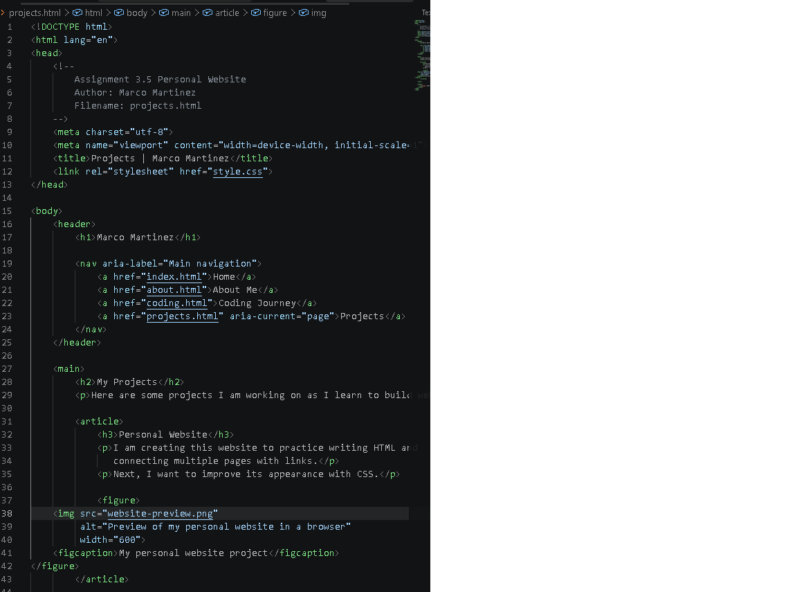

# Marco's Personal Website

## About This Project

Welcome to my personal website!

My name is Marco Martinez, and this website is a personal project where I can share information about myself, my coding experience, and projects I have worked on.

I created this website to practice my web development skills and continue improving my knowledge of HTML and CSS.

This is an ongoing project, and I plan to update and improve it as I learn new skills.

## Website Pages

- **Home:** Introduction to my personal website.
- **About Me:** Information about myself and my interests.
- **Coding:** My coding experience and what I am learning.
- **Projects:** Projects I have worked on and plan to create.

## Technologies Used

- HTML5
- CSS3
- GitHub for version control

## Website Preview

https://mar2391688-lgtm.github.io/marco-personal-site/

## Project Files

- `index.html` — Home page
- `about.html` — About Me page
- `coding.html` — Coding page
- `projects.html` — Projects page
- `style.css` — Website styling
- `my-photo.jpg` — Website image
- `website-preview.png` — Website screenshot

## Future Improvements

As I continue learning web development, I plan to:

- Improve the website's design and layout.
- Add more personal and coding projects.
- Practice responsive design for mobile devices.
- Learn more JavaScript.
- Continue updating the website with new skills and experiences.

## Author

**Marco Martinez**

GitHub: https://github.com/mar2391688-lgtm

## Project Status

**Work in Progress**

This website is a personal learning project that I will continue improving over time.
